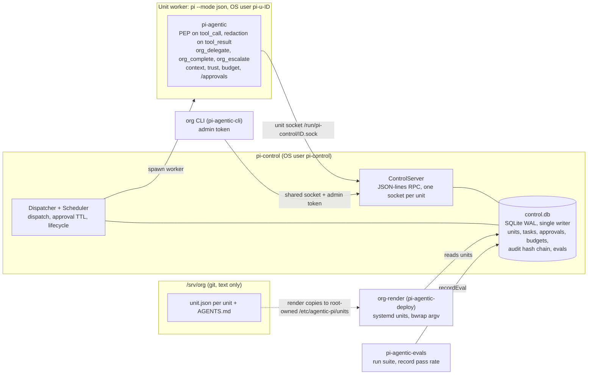

# agentic-pi

An **agentic org** of [Pi](https://pi.dev) agents: a tree of units (CEO → departments → teams) that delegate
scoped work to one another under a default-deny tool policy, a hash-chained audit log, per-unit budgets and a
human approval inbox. Humans handle exceptions; agents do the volume work.

It is built from Pi extensions plus `node:sqlite` only ([ADR-0001](specs/adr/0001-pi-plus-sqlite-only.md)):
zero runtime dependencies in the core, Node ≥ 24, a pure I/O-free kernel, every path default-deny, and an
injected clock for testable time. Targets Pi 1.4.0.

> Status: v0.1.0, pre-release. The packages are not yet published to npm; install from a checkout (below).
> See [CHANGELOG.md](CHANGELOG.md).

## How it fits together



Two ideas carry the design:

- **The hook is the policy enforcement point, not the boundary.** The `tool_call` hook enforces grants and the
  audit trail, but an OS user per unit, systemd hardening and a bubblewrap sandbox for `bash` are the actual trust
  boundary ([ADR-0002](specs/adr/0002-hooks-are-pep-not-boundary.md)).
- **Identity is the socket.** A worker talks to the control plane over its own per-unit Unix socket; the OS
  decides who can connect, and `control.db` is never opened by a worker
  ([ADR-0003](specs/adr/0003-control-plane-mailbox.md)).

## Packages

An npm workspace of seven independently publishable packages with an acyclic dependency graph
([ADR-0006](specs/adr/0006-modular-packages.md)):

| Package | What it is | Depends on |
|---|---|---|
| [`pi-agentic-core`](packages/core) | Pure kernel: manifest parsing, grant algebra, the policy PDP, audit hash chain + off-host anchor, budget math, gate pipeline. No sqlite, no network, no `pi`. | none |
| [`pi-agentic-control-plane`](packages/control-plane) | `control.db` store (sole writer), JSON-lines RPC protocol + peer auth, server, dispatcher, scheduler, the `pi-control` daemon, `ControlClient` (in-process and socket) and the operator `AdminClient`. | core |
| [`pi-agentic`](packages/extension) | The loadable Pi extension: default-deny policy, secret redaction, `org_*` tools, context injection, project trust, budget metering, `/approvals`. | core, control-plane, deploy |
| [`pi-agentic-deploy`](packages/deploy) | systemd unit generators (one Unix user per unit), bubblewrap argv from path grants, the `org-render` CLI. | core, control-plane |
| [`pi-agentic-cli`](packages/cli) | The `org` operator CLI: `org approvals ...`, `org notifications ...`. | core, control-plane |
| [`pi-agentic-evals`](packages/evals) | Eval runner: grade a solver against gate contracts, record the pass rate so lifecycle can deprecate weak units. | core, control-plane |
| [`pi-agentic-durable`](packages/durable) | A pi-durable worker (`agentic-pi-durable-worker`): one Harness per task with the same policy, redaction, budget and `org_*` tools ([ADR-0009](specs/adr/0009-adopt-pi-durable-in-units.md)). | core, control-plane, extension |

New capability goes into a new package or module, never into the core.

## Quick start (development)

Needs Node ≥ 24 and Pi 1.4.0 (`pi` on `PATH`).

```sh
npm install
npm run check        # tsc --build + test-project typecheck, then all tests
```

Sources are `.ts` with explicit `.ts` import extensions. Cross-package imports use the package name; Node resolves
`pi-agentic*` to each package's `src/index.ts` through the `development` export condition, so dev, tests and
`pi -e` need no build step. `npm run build` emits `dist/` (what gets published).

Outside an org the extension refuses to run ungoverned: with no org configuration every tool call is blocked
(fail closed). `AGENTIC_PI_DEV=1` is the explicit opt-in that makes it inert in a plain session:

```sh
AGENTIC_PI_DEV=1 pi -e packages/extension/src/index.ts
```

To exercise governance locally, author a one-unit org and register it with `org units sync`. Under
`AGENTIC_PI_DEV=1`, `ORG_UNIT_ID` + `ORG_CONTROL_DB` select the in-process client (a deployed worker uses
`ORG_CONTROL_SOCKET` instead). A unit's `unit.json` lives at `<org-root>/<path>/unit.json`; `--db` writes
`control.db` directly, which is fine here because no daemon is running (`.tmp/` is git-ignored):

```sh
mkdir -p .tmp/org/dev && cat > .tmp/org/dev/unit.json <<EOF
{
  "id": "dev", "path": "dev", "parent": null, "owner": "me@example.com",
  "grants": ["tool:read", "tool:grep", "path:r:$PWD/.tmp/org/dev/**"],
  "budget": { "tokens": 200000, "costUsd": 5, "wallClockSec": 3600 }
}
EOF
node --conditions development --experimental-strip-types packages/cli/src/main.ts \
  units sync .tmp/org --db .tmp/control.db
cd .tmp/org/dev && AGENTIC_PI_DEV=1 ORG_UNIT_ID=dev ORG_CONTROL_DB="$PWD/../../control.db" \
  ORG_UNIT_MANIFEST="$PWD/unit.json" pi -e ../../../packages/extension/src/index.ts
```

`read` of a file under the granted path succeeds; `write`, `bash` and reads elsewhere are blocked, and every
decision lands in the audit chain. More rehearsals:

```sh
npm run smoke:pi      # real pi binary + scripted fake model, state under ./.tmp (no keys)
npm run simulate:org  # whole flow: org tree, control.db, dispatcher, headless pi workers
```

## Install as a Pi package

`pi-agentic` is a Pi package (`pi-package` keyword, `pi.extensions` = `./dist/index.js`). Once
published it installs with:

```sh
pi install npm:pi-agentic
```

Until then, build and install from the checkout. For a deployed unit, install it into **that unit's own agent
dir** so org-trust participates in `project_trust` (project-scoped extensions cannot decide trust):

```sh
npm run build
PI_CODING_AGENT_DIR=/var/lib/org-units/eng/agent-dir pi install /opt/agentic-pi/packages/extension
```

A local-path install loads in place, so the workspace dependencies resolve through the checkout's
`node_modules`. The package imports no Pi host package at runtime. See [docs/DEPLOY.md](docs/DEPLOY.md) for the
full host setup and [packages/extension](packages/extension) for what it registers.

## The approval inbox

Escalated tasks wait for a human decision. **Approve** re-opens the task as `pending`; **deny** (or a root-level
TTL expiry) cancels it and returns its budget reservation to the parent. Two ways in, both through the control
plane's single writer:

- inside the owner's Pi session: `/approvals`, `/approvals approve <id> [choice]`, `/approvals deny <id> [choice]`
- on the control host: `org approvals list|approve|deny`, and `org notifications [list|ack <id>]`

Details in the [User Guide](docs/USER_GUIDE.md).

## Documentation

| Doc | For |
|---|---|
| [docs/USER_GUIDE.md](docs/USER_GUIDE.md) | Org operators and unit owners: concepts, the `unit.json` manifest, grants, budgets, approvals, lifecycle |
| [docs/DEPLOY.md](docs/DEPLOY.md) | Operators deploying on Linux: topology, systemd, sockets, bubblewrap, audit anchor, smoke test |
| [docs/CONFIGURATION.md](docs/CONFIGURATION.md) | Every `ORG_*` / `AGENTIC_PI_*` environment variable, default and reader |
| [docs/DEVELOPER_GUIDE.md](docs/DEVELOPER_GUIDE.md) | Contributors: repo layout, hooks, RPC protocol, how to extend, testing |
| [specs/SPEC.md](specs/SPEC.md) | Requirements and threat model |
| [specs/PLAN.md](specs/PLAN.md) | Delivery slices S0-S7 and post-S7 packages |
| [specs/adr/](specs/adr) | Architecture decision records |
| [CHANGELOG.md](CHANGELOG.md) | Release notes |

## License

MIT, see [LICENSE](LICENSE).
